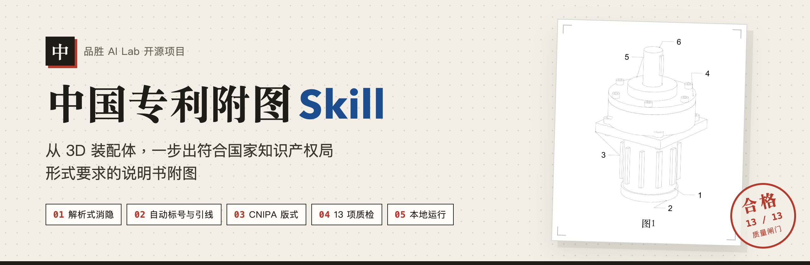
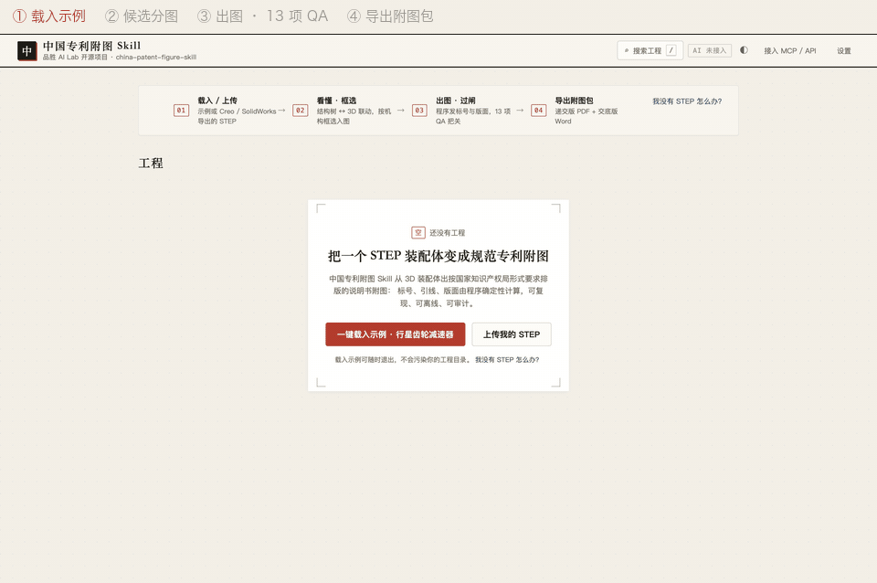

[中文](README.md) | **English**

<p align="center">
  
</p>

<p align="center"><b>Turn a 3D assembly into patent drawings you can file with CNIPA.</b><br>
Load a STEP file. Hidden lines, figure grouping, reference numerals, leader lines and CNIPA page layout are all computed for you. Export PDF · Word · DXF.</p>

**中国专利附图 Skill** (China Patent Figure Skill) is an open-source project by Pisen AI Lab. It is built for the Chinese patent office (CNIPA) first; an experimental USPTO page profile is included.

## Five things it does

1. **Line drawings straight from the 3D model.** OpenCASCADE analytic hidden-line removal on the real B-rep geometry. No screenshot tracing, no generative "drawing".
2. **Reference numerals and leaders, automatically.** Numerals follow numbering rules; leaders never cross or overlap text and land on the right part. Standard parts such as screws and bearings are left unnumbered by default.
3. **CNIPA layout out of the box.** A4, margins top 25 / left 25 / bottom 15 / right 15 mm, caption 「图 N」 centred below the figure, text height at least 3.5 mm, numerals only inside the figure.
4. **Thirteen quality gates.** Overlapping labels, crossing leaders, text height, sheet fill and more. A figure that fails is never exported, and every failure comes with a plain-language reason and fix.
5. **Agent-native, and usable without code.** Plug it into Claude Code, Codex, Trae, CodeBuddy and others as a Skill, over MCP, or from the CLI. People who do not code use the browser workbench. Everything runs locally, so unpublished drawings never leave your machine.

<p align="center">
  
</p>

## What it does, and what stays with you

It takes over the repetitive part of patent drafting: hidden lines, layout, numbering, leaders, text height. The judgement stays with you: which parts go in which figure, how a figure shows the inventive point, how part names match the claims, and the final review.

The AI only fills in blanks. The one file it writes is `figure-plan.json`, which contains no coordinates, no text heights and no numerals. Every line and position is computed by scripts, and the same plan renders the same drawing in a verified environment.

## Quick start

Install [Python 3.12](https://www.python.org/downloads/) (3.9–3.12 supported), then:

```bash
git clone https://github.com/PisenAILab/china-patent-figure-skill.git
cd china-patent-figure-skill
python3 -m venv .venv && source .venv/bin/activate      # Windows: .venv\Scripts\activate
python3 -m pip install -r requirements-pinned.txt -r requirements-web.txt
python3 scripts/pfk_cli.py doctor                       # last line: 结论：可以启动工作台。
python3 scripts/pfk_cli.py start                        # opens the browser workbench
```

- **No terminal:** double-click `安装并启动.command` on macOS, right-click `安装并启动.ps1` and run with PowerShell on Windows, or run `./install.sh` on Linux.
- **As a Claude Code skill:** clone into `~/.claude/skills/china-patent-figure-skill/` and install the requirements; the entry point is [`SKILL.md`](SKILL.md). Codex reads [`AGENTS.md`](AGENTS.md). Other MCP clients: [`docs/mcp-clients.md`](docs/mcp-clients.md).

## What you get

One zip per export: a **filing PDF** (figure numbers and numerals only), a **disclosure Word file** with a numeral-to-part-name table, **DXF sources**, a ready-to-paste figure description, and a checklist of gate results.

> [!IMPORTANT]
> Layout follows CNIPA formal requirements; every rule is cited in [`references/patent-figure-spec.md`](references/patent-figure-spec.md). Acceptance is decided by the patent office. This tool is not legal advice.

## Privacy

Parsing, hidden-line removal, numbering, checks and export all run offline, and the workbench listens on `127.0.0.1` only. AI is optional and used only to suggest part names and structure groups. Set `PFK_AI_PROVIDER=none` before handling confidential models.

## Limitations

- No section views or detail views yet.
- Models with a closed outer housing may have every figure candidate blocked; group parts manually by box selection in 3D.
- STEP input only.
- Verified on macOS; Windows and Linux installers have not been fully verified on real machines yet.

## License

MIT · Pisen AI Lab
