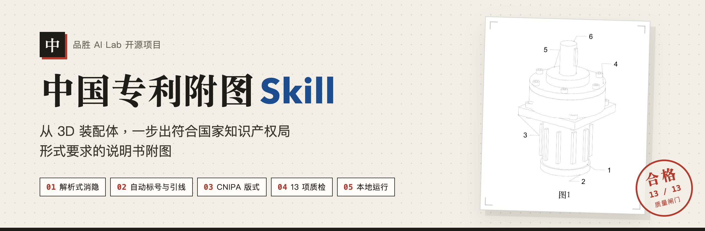
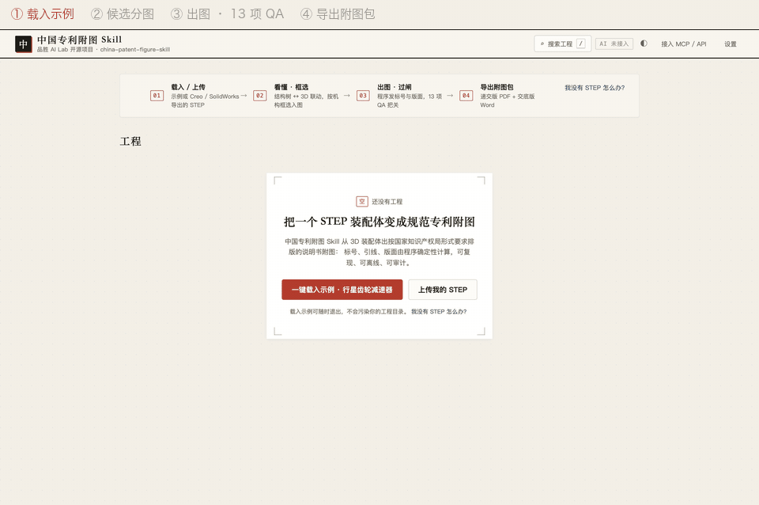
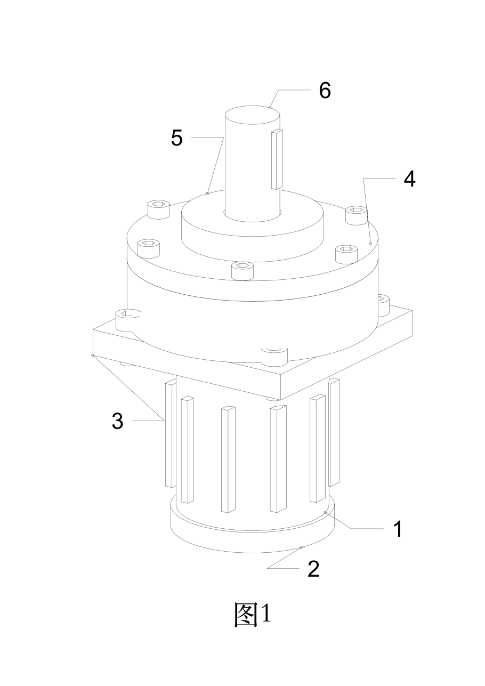
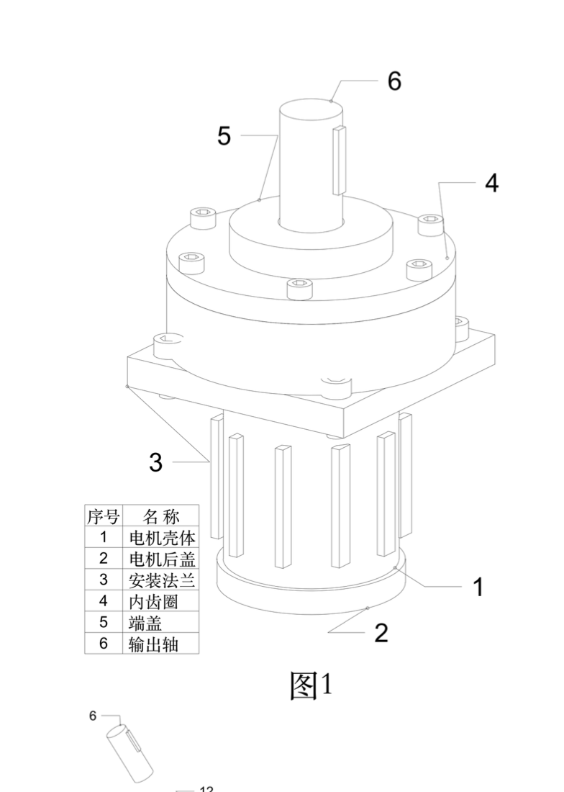
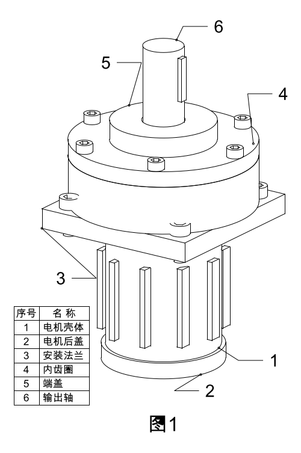
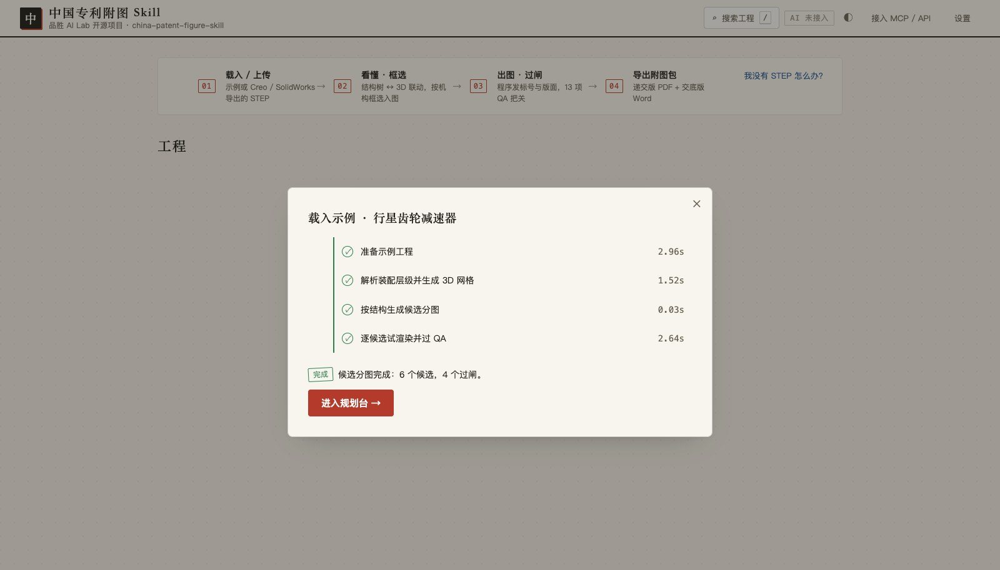
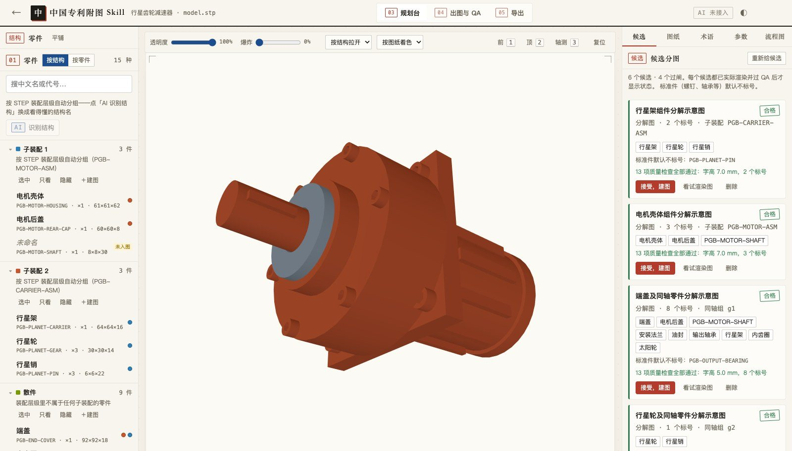
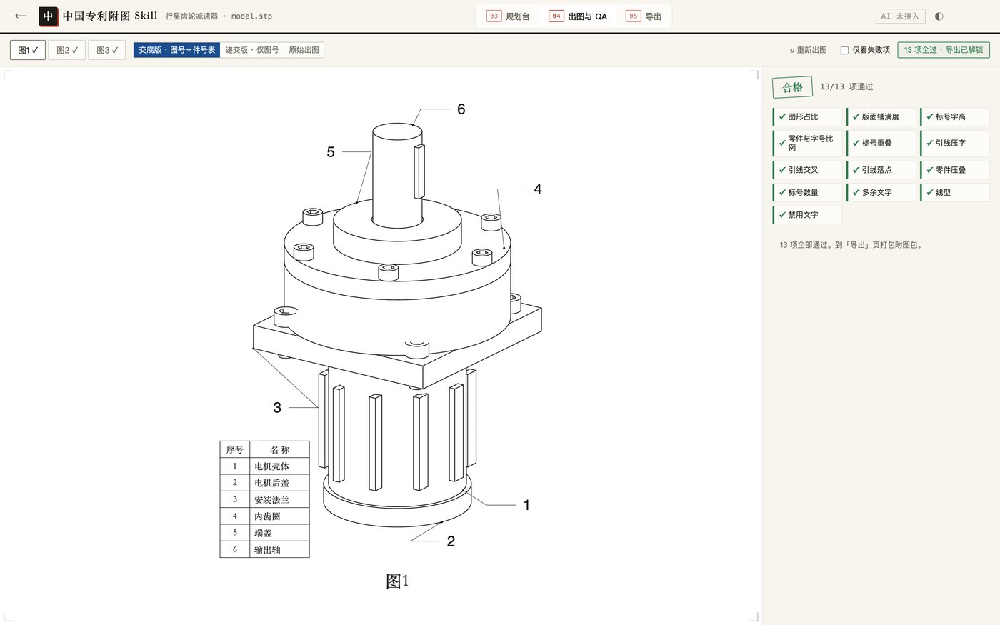
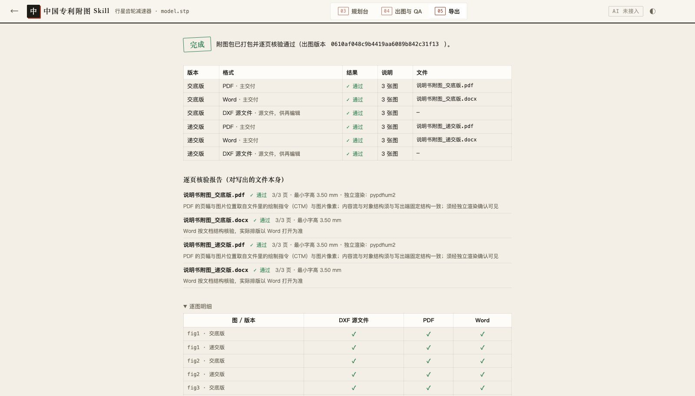
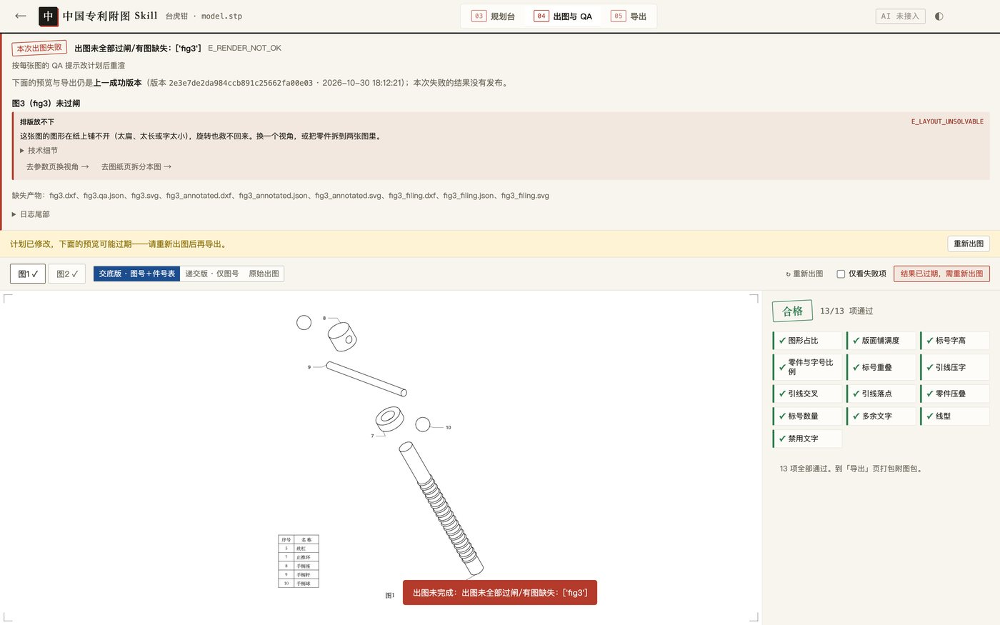

**中文** | [English](README.en.md)

<p align="center">
  
</p>

<p align="center">
  <a href="LICENSE"></a>
  <a href="#三分钟上手"></a>
  <a href="SKILL.md"></a>
  <a href="references/patent-figure-spec.md"></a>
</p>

<p align="center"><b>把 3D 装配体，变成可以直接放进专利申请的说明书附图。</b><br>
导入 STEP，自动消隐、分图、发放附图标记、画引线、按国家知识产权局形式要求排版，导出 PDF · Word · DXF。</p>

## 五个特点

1. **从 3D 模型直接出线条图。** 读入 STEP 装配体，用几何内核做解析式消隐，线条来自真实几何，不是截图描边，也不是生成式模型"画"出来的。
2. **附图标记和引线全自动。** 标号按规则发放，引线不交叉、不压字、落点准确；螺钉、轴承等标准件默认不标号，可以随时改。
3. **按中国专利形式要求排版。** A4 图纸，页边 上 25 / 左 25 / 下 15 / 右 15 mm，「图 N」居中在图下方，字高不低于 3.5 mm，图内只留标号。
4. **13 项质量闸门把关。** 标号重叠、引线交叉、字高、版面铺满度等逐项检查；不通过的图不会被导出，每一项都用白话告诉你原因和改法。
5. **装进你的 AI Agent，也能自己点着用。** 以 Skill、MCP、命令行三种方式接入 Claude Code、Codex、Trae、CodeBuddy 等；不写代码的人用浏览器工作台。全程在本机运行，未公开的图纸不出你的电脑。

<p align="center">
  
  <br><sub>真实录屏：全新数据目录、首次运行、未快进。示例模型由仓库脚本生成，与任何真实产品无关。</sub>
</p>

## 它做什么，你做什么

画附图里最费时间的，是重复劳动：换视角、消隐线、排版、数标号、拉引线、对字高。最值钱的，是判断：保护范围怎么体现、哪个视角最能说明发明点、审查意见怎么答。

**中国专利附图 Skill 只接手前者，把后者留给你。**

| 交给它 | 留给你 |
| --- | --- |
| 从 3D 模型算出消隐线条 | 选哪些零件进哪张图 |
| 按结构给出候选分图，并逐张试出图 | 确认分图是否体现发明点 |
| 发放附图标记、排引线、避让文字 | 给零件定名称，和说明书、权利要求对上 |
| 按形式要求排版、检查、导出 | 最终审核，并对申请文件负责 |

AI 在这里只做"填空"：它写的唯一文件是一份分图计划 `figure-plan.json`，里面没有坐标、没有字高、没有标号。所有线条和位置都由脚本计算，同一份计划在已验证环境下每次出图结果一致，可以复查、可以追溯。

## 三分钟上手

先装好 [Python 3.12](https://www.python.org/downloads/)（3.9–3.12 均可；Windows 安装时勾选「Add python.exe to PATH」），再下载本仓库：

```bash
git clone https://github.com/PisenAILab/china-patent-figure-skill.git
```

然后选一条路：

**① 不想碰命令行：双击安装**

| 系统 | 操作 |
| --- | --- |
| Windows | 右键 `安装并启动.ps1`，选「使用 PowerShell 运行」 |
| macOS | 双击 `安装并启动.command`；首次被拦时右键选「打开」 |
| Linux | 终端运行 `./install.sh` |

脚本会建独立环境、装依赖、自检，然后打开浏览器工作台。点「一键载入示例」，就能看到完整流程。

**② 在 AI Agent 里用：作为 Skill 安装**

```bash
git clone https://github.com/PisenAILab/china-patent-figure-skill.git ~/.claude/skills/china-patent-figure-skill
cd ~/.claude/skills/china-patent-figure-skill
python3 -m pip install -r requirements-pinned.txt -r requirements-web.txt
```

之后对 Agent 说「用这个 STEP 出专利附图」即可，入口是 [`SKILL.md`](SKILL.md)。Codex 读 [`AGENTS.md`](AGENTS.md)；其他客户端走 MCP，各家写法见 [`docs/mcp-clients.md`](docs/mcp-clients.md)。

**③ 开发者：命令行**

```bash
cd china-patent-figure-skill
python3 -m venv .venv && source .venv/bin/activate      # Windows：.venv\Scripts\activate
python3 -m pip install -r requirements-pinned.txt -r requirements-web.txt
python3 scripts/pfk_cli.py doctor                       # 最后一行应为：结论：可以启动工作台。
python3 scripts/pfk_cli.py start                        # 打开浏览器工作台
```

<details>
<summary>不开界面，一条龙出一套附图包（冒烟测试）</summary>

```bash
mkdir -p "$HOME/pfk-demo"
python3 scripts/make_demo_assemblies.py -o "$HOME/pfk-demo"
cp examples/planetary-gearbox/figure-plan.json "$HOME/pfk-demo/"
python3 scripts/analyze_assembly.py "$HOME/pfk-demo/demo-planetary-gearbox.stp" -o "$HOME/pfk-demo/assembly.json" --include 'PGB-*'
python3 scripts/export_figure_package.py "$HOME/pfk-demo/figure-plan.json" --assembly "$HOME/pfk-demo/assembly.json" -o "$HOME/pfk-demo/附图包"
```

预期：6 行 `[通过]`，最后显示「全部通过」，退出码 0；`附图包/` 里有 `说明书附图_递交版.pdf`。

</details>

<!-- For AI agents: non-interactive install + smoke test from a source checkout. No credentials, no AI channel, nothing leaves the machine.
git clone https://github.com/PisenAILab/china-patent-figure-skill.git && cd china-patent-figure-skill
python3 -m venv .venv && . .venv/bin/activate
python3 -m pip install -U pip && python3 -m pip install -r requirements-pinned.txt -r requirements-web.txt
python3 scripts/pfk_cli.py doctor            # expect last line: 结论：可以启动工作台。 (exit 0)
then run the smoke test above. Expected: six "[通过]" lines and "（全部通过）", exit 0.
Python must be 3.9–3.12. Full acceptance (several minutes): python3 acceptance/run_acceptance.py — do not pipe it, the exit code matters. -->

## 你会拿到什么

点「导出附图包」，得到一个压缩包：

- **递交版 PDF**：只有图号与附图标记，按形式要求排版，用于提交。
- **交底版 Word**：多一张"标号—零件名称"对照表，方便和发明人、代理师核对。
- **DXF 源文件**：可以继续在 CAD 里编辑；装了 AutoCAD 或 LibreDWG 还能转 DWG。
- **《附图说明》文本**：可直接粘进说明书的「附图说明」一节。
- **《核对清单》**：逐张列出闸门结果和需要人工确认的事项。

<table>
<tr>
<td align="center" width="33%"><br><sub>递交版 PDF</sub></td>
<td align="center" width="33%"><br><sub>交底版 Word（预览图，实际分页以 Word 打开为准）</sub></td>
<td align="center" width="33%"><br><sub>DXF 源文件</sub></td>
</tr>
</table>

> [!IMPORTANT]
> 版式按国家知识产权局形式要求排版，规则出处逐条列在 [`references/patent-figure-spec.md`](references/patent-figure-spec.md)。精确图片参数以当期《电子申请文件格式要求说明》为准；最终以受理为准，本工具不构成法律意见。

## 在工作台里怎么用

<table>
<tr>
<td align="center" width="25%"><br><sub><b>① 导入</b><br>拖入 STEP，自动解析装配层级</sub></td>
<td align="center" width="25%"><br><sub><b>② 选图</b><br>按结构给出候选分图，过闸的盖绿章</sub></td>
<td align="center" width="25%"><br><sub><b>③ 出图</b><br>13 项闸门逐项给结论</sub></td>
<td align="center" width="25%"><br><sub><b>④ 导出</b><br>PDF · Word · DXF 一次拿到</sub></td>
</tr>
</table>

不通过时不会给你一张"看起来差不多"的图，而是告诉你卡在哪、怎么改：

<p align="center"></p>

<details>
<summary>13 项质量闸门分别查什么</summary>

| 检查项 | 通过条件 |
| --- | --- |
| 图形占比 | 图形占图区足够大，不留大片空白 |
| 版面铺满度 | 排版充分利用版心 |
| 标号字高 | 不低于 3.5 mm |
| 零件与字号比例 | 标号不比所指零件还大 |
| 标号重叠 | 0 处 |
| 引线压字 | 0 处 |
| 引线交叉 | 0 处 |
| 引线落点 | 引线端点落在所指零件上 |
| 零件压叠 | 爆炸图里零件互不遮挡 |
| 标号数量 | 每张图不超过 20 个，超了建议拆图 |
| 多余文字 | 图内只留标号 |
| 线型 | 只用连续实线 |
| 禁用文字 | 图内没有注释性文字 |

</details>

## 数据与隐私

- **出图全部在本机完成。** 解析、消隐、标号、质检、导出都不联网；工作台默认只监听 `127.0.0.1`。
- **AI 是可选项。** 只用于给零件起名、识别结构分组。检测到 `DEEPSEEK_API_KEY` 或本机 CodeBuddy 时会默认开启，并会外发零件名、尺寸、装配路径等派生信息，不外发 STEP 文件和几何数据。
- **处理保密模型前请先关闭 AI**：启动前设置 `PFK_AI_PROVIDER=none`，首页显示「AI 未接入」即为关闭。

## 已知限制

- 目前只出线条图，不做剖视图和局部放大图。
- 带封闭外壳的模型，候选分图可能被闸门全部拦下，需要在 3D 里手动框选零件分组。
- 只读 STEP；其他格式请先在 CAD 里导出为 STEP。
- macOS 已实机验证；Windows 与 Linux 安装脚本尚未在真机上完整验证，欢迎反馈。
- 交底版 Word 只做结构核验，实际分页以 Word 打开为准。

## 文档

| 文档 | 内容 |
| --- | --- |
| [`SKILL.md`](SKILL.md) | 给 AI Agent 的完整工作流 |
| [`references/patent-figure-spec.md`](references/patent-figure-spec.md) | 中国专利附图形式要求与出处 |
| [`docs/impl-contract.md`](docs/impl-contract.md) | 模块接口、确定性规则与排版算法 |
| [`docs/deploy/`](docs/deploy/) | 本地、服务器与在线演示站部署 |
| [`acceptance/README.md`](acceptance/README.md) | 19 项验收节点：怎么证明这台机器出图正确 |

## 参与与许可

欢迎提 Issue 和 PR。提交前请运行 `python3 acceptance/run_acceptance.py`，确认全部通过，细则见 [`CONTRIBUTING.md`](CONTRIBUTING.md)。

MIT 许可证 · 品胜 AI Lab 开源项目
